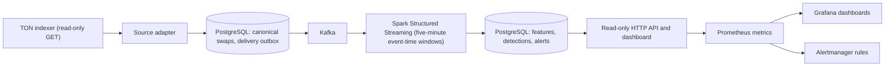

# ton-sentinel

TON Sentinel scores STON.fi and DeDust swap activity per token in five-minute windows and explains which tokens departed from their recent behaviour, and why.

It reads swaps from a TON Center v3 compatible indexer, aggregates them per token, and persists explainable anomaly scores as detections and alerts. Not a trading tool or fraud classifier.

## Status

Active: local-first engineering project, not production. Last substantive change: 2026-11-18. Known gaps are listed under Limitations, Known gaps and in [docs/OPERATIONS.md](docs/OPERATIONS.md).

## Limitations

- Budgets: 6 GB RAM and 2 CPU cores, local ceilings from `deploy/workload/acceptance.json`.
- No labelled data, so detector quality is unmeasured. A flagged window is a prompt to look.
- Not verified: sustained live load, ARM64, cloud deployment.

## Architecture



- **Source adapter** (`src/ton_sentinel/source`): normalizes STON.fi and DeDust swaps from
  indexer actions and traces. A key, if configured, is sent only to the configured host.
- **PostgreSQL** holds the canonical state: swap history and revisions, the delivery outbox,
  checkpoints, features, detections and alerts. Migrations live in `src/ton_sentinel/db/migrations`.
- **Kafka** buffers delivery; **Spark Structured Streaming** computes windowed features.
- **Detectors** (`src/ton_sentinel/detectors.py`): two explainable robust-score detectors
  (median and MAD over earlier windows), one for swap count and one for unique active wallets.
- **API and dashboard** (`src/ton_sentinel/api.py`, `src/ton_sentinel/dashboard`): GET-only,
  bound to loopback, reading through a least-privilege database role.
- **Monitoring** (`deploy/compose.monitoring.yaml`, `deploy/monitoring`): Prometheus scrapes the
  API metrics; Grafana and Alertmanager run beside it, all bound to loopback.
- **Helm chart** (`deploy/helm/ton-sentinel`), with local k3d values in `deploy/helm/local`.

### Key design decisions

- **PostgreSQL is canonical state, Kafka is a delivery buffer.** Swaps, revisions, the outbox,
  checkpoints and detections live in PostgreSQL, so Kafka can be replayed or lost without losing
  data. Trade-off: an outbox and checkpoints to maintain, and one more hop per swap.
- **Robust-score detectors (median and MAD over earlier windows).** Two detectors, swap count
  and unique active wallets, each with a score a reader can recompute by hand. Trade-off: less
  sensitive than a learned model, and effectiveness is not measured for lack of labelled data.
- **Unknown stays unknown.** Unknown traders, missing coverage and short history are shown as
  such instead of becoming zeros or invented counts. Trade-off: sparser dashboards.
- **Loopback-only, read-only surface.** The API is GET-only, services bind to loopback, and the
  API reads through a least-privilege database role. Trade-off: no remote access without extra
  setup. Details in [docs/SECURITY.md](docs/SECURITY.md).
- **Local-first, pinned builds.** Images are pinned by digest and the app image is built
  locally. Trade-off: new builds must be re-pinned, and nothing is published.

### Repository layout

| Path | Contents |
|---|---|
| `src/ton_sentinel/` | Source adapter, database layer and migrations, Spark jobs, detectors, API, dashboard |
| `tests/` | `unit/`, `integration/` (real services), `fixtures/` (recorded public on-chain data, URLs stripped) |
| `scripts/` | `qualify` (static and qualification gates), `local-check`, `local-stack-check` |
| `docs/` | Operations and security notes |
| `deploy/` | Compose files, app Dockerfile, image lock, monitoring config, Helm chart, workload envelope |

## Quick start

Requirements: Linux x86_64, Python 3.10 or newer, [uv](https://docs.astral.sh/uv/), Docker with Compose v2, and Helm 3 for the static gate.

```bash
git clone <this repository> ton-sentinel && cd ton-sentinel

# 1. Python environment for the host test suite (from uv.lock, includes the dev group)
uv sync --locked

# 2. Local settings: copy the template and replace the placeholders (.env is git-ignored)
cp .env.example .env

# 3. Local PostgreSQL and Kafka (images pinned by digest)
docker compose --env-file .env -p ton-sentinel-local -f deploy/compose.yaml up -d --wait postgres kafka

# Stop and remove the local stack
docker compose --env-file .env -p ton-sentinel-local -f deploy/compose.yaml down --volumes
```

Always pass `--env-file .env`. Image build, pinning and integration tests are described in [docs/OPERATIONS.md](docs/OPERATIONS.md).

## Configuration

Settings come from `.env`, created from [`.env.example`](.env.example). Never commit `.env`.

| Variable | Required | Purpose |
|---|---|---|
| `TON_SENTINEL_PG_PASSWORD` | Yes | Password of the local PostgreSQL fixture (compose service `postgres`) |
| `TONCENTER_BASE_URL` | No | TON Center v3 compatible indexer for live reads |
| `TONCENTER_API_KEY` | No | Indexer key, sent only to `TONCENTER_BASE_URL` as the `X-Api-Key` header |

## Testing

```bash
# Unit suite
uv run python -m pytest -q tests/unit

# Static gate (Helm on PATH, or set TON_SENTINEL_HELM)
uv run python scripts/qualify static
```

Integration tests (`tests/integration`) run inside the `app` container against real PostgreSQL, Kafka and Spark; see [docs/OPERATIONS.md](docs/OPERATIONS.md).

## Deployment

Not deployed; local only. Compose files and a Helm chart for a local k3d cluster live in `deploy/`.

## Docs index

- [docs/OPERATIONS.md](docs/OPERATIONS.md): local stack, image build context, scheduling, budgets, status and known gaps.
- [docs/SECURITY.md](docs/SECURITY.md): network exposure, database access, indexer key, secrets, fixtures and image pinning.

## Known gaps

- No CI workflow: there is no `.github/` directory, so tests and the static gate run only locally.
- No linter or formatter is configured.
- The image build context is assembled by hand: the Spark connector jars listed in `deploy/images.lock.json` are not in the repository.
- No `docs/ARCHITECTURE.md`; the architecture is described only in this README.
- Not deployed: no hosting, backups or high availability.

## License

MIT. See [LICENSE](LICENSE).
